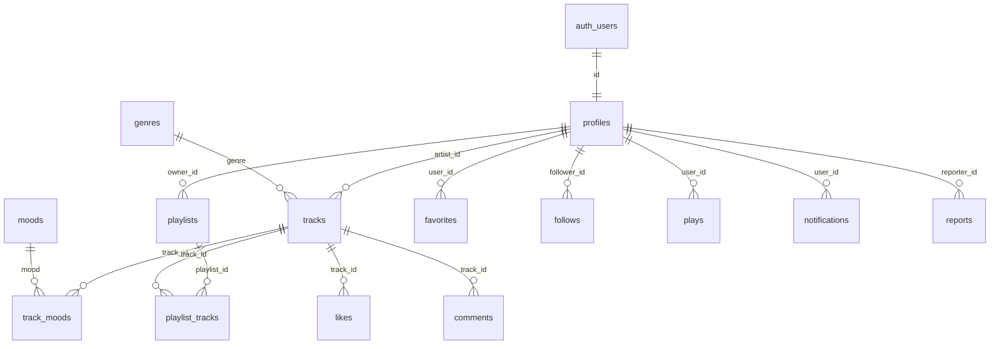

# Mars Sound AI — Banco de dados (Supabase)

Schema real do projeto Supabase `qxnbztrwbiffhthlzrzy` (Postgres 17). A **fonte da verdade** são as migrations em [`supabase/migrations/`](./supabase/migrations); este documento explica o modelo, as regras de acesso e como evoluí-lo.

> A versão anterior deste arquivo descrevia um schema Prisma que nunca foi implantado. Ele foi substituído por este modelo, que segue os contratos do front (`src/app/services/contracts.ts`) e o Supabase Auth. Prisma não é usado.

## Índice

1. [Visão geral](#1-visão-geral)
2. [Migrations](#2-migrations)
3. [Tipos enumerados](#3-tipos-enumerados)
4. [Tabelas](#4-tabelas)
5. [Funções e triggers](#5-funções-e-triggers)
6. [View e RPCs](#6-view-e-rpcs)
7. [Segurança: privilégios e RLS](#7-segurança-privilégios-e-rls)
8. [Storage](#8-storage)
9. [Edge Function `delete-account`](#9-edge-function-delete-account)
10. [Seed](#10-seed)
11. [Testes e verificação](#11-testes-e-verificação)
12. [Configuração manual no painel](#12-configuração-manual-no-painel)
13. [Como evoluir o schema](#13-como-evoluir-o-schema)

---

## 1. Visão geral

| Schema | Conteúdo | Exposto na Data API? |
|---|---|---|
| `public` | Tabelas, view `tracks_with_artist` e RPCs chamadas pelo front | Sim (somente para `authenticated`) |
| `private` | Funções `security definer`, funções de trigger e helpers | **Não** |
| `extensions` | `pg_trgm` (busca por trigramas) e `unaccent` (busca sem acentos) | Não |

Princípios:
- **Todo o app exige login.** `anon` não tem nenhum privilégio em `public`; leitura e escrita são sempre `to authenticated`.
- **Ids são `uuid`.** O perfil usa o mesmo id de `auth.users` e é criado por trigger no cadastro.
- **Mídia no Storage, caminho no banco.** As colunas `*_path` guardam o caminho do objeto; o serviço converte em URL pública.
- **Contadores desnormalizados** (`play_count`, `like_count`, `followers_count`, `following_count`) são mantidos por triggers e não podem ser escritos pelo cliente.
- **Gênero e mood são guardados pelo nome** (ex.: `"Eletrônica"`), com chave estrangeira para as tabelas de referência e `on update cascade`.

## 2. Migrations

Aplicadas pelo MCP do Supabase, na ordem:

| Versão | Nome | Conteúdo |
|---|---|---|
| `20261009143118` | `001_foundation` | `pg_trgm`, schema `private`, enums, `genres` e `moods` |
| `20261009143127` | `002_core_tables` | Tabelas usadas pelo front e seus índices |
| `20261009143133` | `003_future_tables` | `likes`, `comments`, `notifications`, `reports`, `audit_logs` |
| `20261009143500` | `004_functions_triggers` | `unaccent`, helpers, triggers, coluna `search_document` |
| `20261009143513` | `005_rls_policies` | Privilégios por coluna e políticas RLS |
| `20261009143545` | `006_rpcs` | View `tracks_with_artist` e RPCs |
| `20261009143614` | `006b_revoke_private_helpers_execute` | Remove `EXECUTE` de `PUBLIC` nos helpers de `private` |
| `20261009143809` | `007_storage` | Buckets e políticas de `storage.objects` |
| `20261009143815` | `008_seed_reference_data` | Gêneros e moods |
| `20261009145858` | `009_playlists_with_details` | View `playlists_with_details` usada pelo front |
| `20261009153022` | `010_media_path_ownership_and_play_dedup` | `CHECK` de dono nos caminhos de mídia, deduplicação de plays e de notificações de follow |
| `20261010172613` | `011_catalog_options` | Tabela `ai_generators` (com seed) e RPC `get_popular_tags`, para o front não ter opções de catálogo fixas no código |

## 3. Tipos enumerados

| Enum | Valores |
|---|---|
| `user_role` | `user`, `creator`, `admin`, `moderator` |
| `track_status` | `draft`, `processing`, `published`, `archived`, `rejected` |
| `report_status` | `pending`, `reviewed`, `resolved`, `dismissed` |
| `notification_type` | `like`, `comment`, `follow`, `playlist_add`, `new_track`, `system` |

## 4. Tabelas

### Referência
| Tabela | Colunas | Observações |
|---|---|---|
| `genres` | `name` (PK), `slug` (único), `color` (`#RRGGBB`), `sort_order`, `created_at` | Somente leitura para o app |
| `moods` | Mesma estrutura | Somente leitura para o app |
| `ai_generators` | `name` (PK, 1–50 caracteres), `sort_order`, `created_at` | Somente leitura para o app. Apenas sugestões do campo "IA geradora": `tracks.ai_generator` continua texto livre, sem chave estrangeira |

### Núcleo (usado pelo front)

**`profiles`** — um por usuário do Auth.

| Coluna | Tipo | Regra |
|---|---|---|
| `id` | `uuid` PK | FK `auth.users(id)` `on delete cascade` |
| `display_name` | `text` | 2 a 50 caracteres |
| `handle` | `text` único | `^[a-z0-9_.]{3,30}$` |
| `bio` | `text` | até 160, padrão `''` |
| `avatar_path`, `banner_path` | `text` | Caminho no bucket `user-avatars` |
| `is_public` | `boolean` | padrão `true` |
| `favorite_genres`, `moods` | `text[]` | Validados contra `genres`/`moods`; duplicatas removidas |
| `followers_count`, `following_count` | `integer` | Mantidos por trigger |
| `role` | `user_role` | padrão `user`; só alterável pelo painel/service role |
| `last_login_at` | `timestamptz` | Reservado |
| `created_at`, `updated_at` | `timestamptz` | `updated_at` só muda em colunas editáveis |

**`tracks`**

| Coluna | Tipo | Regra |
|---|---|---|
| `id` | `uuid` PK | Pode ser gerado no cliente (usado no caminho do áudio) |
| `artist_id` | `uuid` | FK `profiles`; sempre o usuário logado |
| `title` | `text` | 1 a 80 |
| `genre` | `text` | FK `genres(name)` |
| `album` | `text` | até 80 |
| `description` | `text` | até 500 |
| `tags` | `text[]` | até 10 |
| `ai_generator` | `text` | até 50 |
| `prompt` | `text` | até 1000 |
| `audio_path` / `cover_path` | `text` | Buckets `audio-tracks` / `track-covers` |
| `duration_seconds` | `integer` | > 0 |
| `file_size_bytes` | `bigint` | 1 B a 50 MB |
| `audio_format` | `text` | `mp3` ou `wav` |
| `play_count`, `like_count` | contadores | Mantidos por trigger |
| `status` | `track_status` | padrão `published` |
| `published_at`, `created_at`, `updated_at` | `timestamptz` | |
| `search_document` | `text` gerada | Título, álbum, gênero e tags normalizados (minúsculas, sem acentos); índice trigram |

**Demais tabelas do núcleo**

| Tabela | Chave | Observações |
|---|---|---|
| `track_moods` | (`track_id`, `mood`) | Máximo de 3 por faixa (trigger); `mood` FK `moods(name)` |
| `playlists` | `id` | `title` 1–60, `description` até 300, `cover_path`, `is_public` |
| `playlist_tracks` | (`playlist_id`, `track_id`) | `position` ≥ 0, único por playlist e `deferrable` (permite reordenar numa transação) |
| `favorites` | (`user_id`, `track_id`) | Ordenados por `created_at` |
| `follows` | (`follower_id`, `followed_id`) | Não é possível seguir a si mesmo |
| `plays` | `id` identity | `played_at` sempre definido pelo servidor; repetições em sequência são agrupadas (seção 5) |

**Dono dos arquivos (`CHECK`, migration 010):** todo caminho de mídia precisa começar pela pasta do dono da linha — `tracks.audio_path`/`cover_path` por `artist_id`, `playlists.cover_path` por `owner_id`, `profiles.avatar_path`/`banner_path` por `id`. Uma linha nunca aponta para arquivos de outro usuário (violação → `23514`).

### Futuras (já protegidas por RLS, ainda não usadas pelo front)

| Tabela | Uso previsto |
|---|---|
| `likes` | Curtidas; mantém `tracks.like_count` e notifica o artista |
| `comments` | Comentários com respostas (`parent_id`), até 1000 caracteres |
| `notifications` | Notificações de follow e like (criadas por trigger); usuário só marca como lida |
| `reports` | Denúncias de faixa, comentário, usuário ou playlist; moderação pela equipe |
| `audit_logs` | Registro de ações administrativas; somente leitura para a equipe |

### Índices principais
- `tracks`: (`artist_id`, `created_at desc`), (`status`, `created_at desc`), (`status`, `play_count desc`), (`genre`), GIN trigram em `search_document`, GIN em `tags`.
- `profiles`: GIN trigram em `handle`, (`followers_count desc`).
- `favorites` (`user_id`, `created_at desc`), `plays` (`user_id`, `played_at desc`) e (`track_id`, `played_at desc`), além de um índice em cada chave estrangeira.

## 5. Funções e triggers

Todas as funções têm `search_path = ''` e referenciam objetos com o schema. Funções `security definer` ficam em `private`, fora da Data API.

| Função (`private`) | Tipo | O que faz |
|---|---|---|
| `handle_new_user` | trigger `after insert on auth.users` (definer) | Cria o perfil: nome de `raw_user_meta_data.display_name` ou do e-mail; handle único derivado do e-mail (sufixo aleatório em colisões, à prova de cadastros simultâneos) |
| `touch_updated_at` | trigger `before update` | `profiles`, `tracks` (só colunas editáveis), `playlists`, `comments` |
| `collapse_repeated_play` | trigger `before insert on plays` (definer) | Se o mesmo usuário já tocou a faixa dentro da duração dela (mínimo 30 s), só renova o `played_at` do play anterior e descarta a inserção: recentes continuam corretos, mas `play_count` e o ranking semanal não podem ser inflados |
| `increment_play_count` | trigger `after insert on plays` (definer) | `tracks.play_count + 1` |
| `sync_follow_counts` | trigger em `follows` (definer) | Atualiza os dois contadores num único `UPDATE` (evita deadlock) |
| `sync_like_count` | trigger em `likes` (definer) | `tracks.like_count ± 1` |
| `enforce_max_track_moods` | trigger em `track_moods` (definer) | Trava a faixa e recusa o 4º mood (`23514`) |
| `validate_profile_preferences` | trigger em `profiles` | Remove duplicatas e recusa gênero/mood inexistente (`23514`) |
| `notify_on_follow`, `notify_on_like` | triggers (definer) | Criam notificações (nunca para si mesmo); seguir de novo o mesmo perfil em até 24 h não gera nova notificação |
| `is_staff()` | helper (definer) | `true` para `admin`/`moderator`; usado nas políticas |
| `get_profile_handle(uuid)` | helper (definer) | Expõe **apenas** o handle (para mostrar o @ de artistas com perfil privado) |
| `weekly_play_counts(timestamptz)` | helper (definer) | Total de plays por faixa publicada desde a data (o RLS de `plays` só mostra os próprios) |
| `normalize_search_text`, `tracks_search_document` | helpers imutáveis | Normalização da busca |
| `clamp_limit`, `claim_owned_playlist` | helpers (invoker) | Limite 1–50 e trava/valida posse da playlist |

## 6. View e RPCs

**`public.tracks_with_artist`** (`security_invoker = true`): todas as colunas de `tracks` (exceto `search_document`) mais `artist_handle` e `moods` (array ordenado). Somente leitura. Respeita o RLS de `tracks`.

**`public.playlists_with_details`** (`security_invoker = true`, migration 009): colunas de `playlists` mais `owner_handle` (via `get_profile_handle`, para playlists públicas de perfis privados) e `track_ids` (array na ordem de `position`, `'{}'` quando vazia). Somente leitura para `authenticated`; respeita o RLS de `playlists` e `playlist_tracks`.

RPCs em `public`, todas `security invoker` (o RLS se aplica) e executáveis apenas por `authenticated`:

| RPC | Retorno | Regras |
|---|---|---|
| `get_profile_stats(p_user_id)` | `tracks_count`, `total_plays`, `followers_count`, `following_count` | Vazio se o perfil não for visível; conta só faixas publicadas |
| `search_tracks(p_query, p_genres, p_moods, p_sort, p_offset, p_limit)` | Colunas da view + `total_count` | Texto sem acentos/maiúsculas em título, álbum, gênero, tags e @handle; gêneros com OR; moods com "qualquer um"; `p_sort` = `popular` ou `recent` (outro valor → `23514`); limite 1–50 |
| `get_recommended_tracks(p_limit)` | `setof tracks_with_artist` | Usa `auth.uid()`; gênero preferido vale 2, cada mood em comum vale 1; completa com as populares; exclui as do próprio usuário |
| `get_weekly_highlights(p_limit)` | `setof tracks_with_artist` | Mais tocadas em 7 dias, completando com as populares |
| `get_recently_played(p_limit)` | `track_id`, `last_played_at` | Faixas distintas do usuário, ainda visíveis |
| `get_featured_genres(p_limit)` | `genre`, `track_count` | Gêneros com faixas publicadas |
| `get_popular_tags(p_limit = 10)` | `tag`, `track_count` | Tags mais usadas em faixas publicadas (rascunhos não entram). `security invoker`; `EXECUTE` só para `authenticated` |
| `add_track_to_playlist(p_playlist_id, p_track_id)` | `void` | Posição no fim; playlist alheia/inexistente ou música invisível → `PT404`; duplicada → `PT409` |
| `remove_track_from_playlist(p_playlist_id, p_track_id)` | `void` | Remove e recompacta as posições |
| `reorder_playlist_tracks(p_playlist_id, p_track_ids)` | `void` | Exige exatamente o mesmo conjunto, sem duplicatas (senão `PT409`) |

Os códigos `PTxyz` são convertidos pelo PostgREST no status HTTP `xyz` (404/409).

## 7. Segurança: privilégios e RLS

### Privilégios por coluna
Revogar uma coluna não tem efeito quando o papel tem o privilégio na tabela inteira (padrão do Supabase). Por isso a migration 005 revoga `insert/update/delete/truncate/references/trigger` de `authenticated` e concede só o que o app precisa:

| Tabela | INSERT | UPDATE | DELETE |
|---|---|---|---|
| `profiles` | — (trigger) | `display_name`, `handle`, `bio`, `avatar_path`, `banner_path`, `is_public`, `favorite_genres`, `moods` | — |
| `tracks` | `id`, `artist_id`, `title`, `genre`, `album`, `description`, `tags`, `ai_generator`, `prompt`, `audio_path`, `cover_path`, `duration_seconds`, `file_size_bytes`, `audio_format`, `status` | `title`, `genre`, `album`, `description`, `tags`, `ai_generator`, `prompt`, `cover_path`, `status` | sim |
| `track_moods` | `track_id`, `mood` | — | sim |
| `playlists` | `id`, `owner_id`, `title`, `description`, `cover_path`, `is_public` | os mesmos sem ids (+ `updated_at`, sempre sobrescrito pelo trigger) | sim |
| `playlist_tracks` | `playlist_id`, `track_id`, `position` | `position` | sim |
| `favorites`, `likes` | `user_id`, `track_id` | — | sim |
| `follows` | `follower_id`, `followed_id` | — | sim |
| `plays` | `user_id`, `track_id` | — | — |
| `comments` | `id`, `user_id`, `track_id`, `parent_id`, `content` | `content` | sim |
| `notifications` | — (trigger) | `is_read`, `read_at` | — |
| `reports` | `reporter_id`, `entity_id`, `entity_type`, `reason`, `description` | `status`, `resolved_by`, `resolved_at` (só equipe, via RLS) | — |
| `genres`, `moods`, `ai_generators`, `audit_logs` | — | — | — |

### Políticas RLS
RLS ativo em 100% das tabelas de `public`. Uma política por comando; `auth.uid()` e `is_staff()` dentro de `(select …)` para cache por consulta.

| Tabela | Leitura | Escrita |
|---|---|---|
| `profiles` | Públicos, o próprio ou equipe | Só o próprio |
| `tracks` | Publicadas, as próprias ou equipe | Inserir como `draft`/`published`; editar as próprias (exceto `rejected`), status final `draft`/`published`/`archived`; excluir as próprias ou equipe |
| `track_moods` | Herda a visibilidade da faixa | Só o artista da faixa |
| `playlists` | Públicas ou as próprias | Só o dono |
| `playlist_tracks` | Herda a visibilidade da playlist | Só o dono; a faixa precisa ser visível |
| `favorites`, `likes` | As próprias | As próprias; faixa visível |
| `follows` | Todos | Só o seguidor |
| `plays` | As próprias | As próprias; faixa visível |
| `comments` | Em faixas visíveis | Autor (excluir: autor ou equipe) |
| `notifications` | As próprias | Marcar como lida |
| `reports` | As próprias ou equipe | Criar as próprias; equipe atualiza |
| `audit_logs` | Equipe | — |
| `genres`, `moods`, `ai_generators` | Todos os autenticados | — |

Consequências de produto:
- Playlist privada de outro usuário não aparece (o serviço responde `not_found`).
- Perfil privado não aparece, mas as faixas publicadas dele continuam no catálogo com o @handle.
- Rascunhos (`draft`) só são vistos pelo próprio artista.

## 8. Storage

| Bucket | Público | Limite | Tipos MIME |
|---|---|---|---|
| `audio-tracks` | sim | 50 MB | `audio/mpeg`, `audio/mp3`, `audio/wav`, `audio/x-wav`, `audio/wave` |
| `track-covers` | sim | 2 MB | `image/jpeg`, `image/png` |
| `user-avatars` | sim | 2 MB | `image/jpeg`, `image/png` |
| `playlist-covers` | sim | 2 MB | `image/jpeg`, `image/png` |

- **Caminho obrigatório:** `<auth.uid()>/<arquivo>`. As quatro políticas de `storage.objects` (select, insert, update, delete) só valem quando a primeira pasta é o id do usuário. Upsert exige as três primeiras, que já existem.
- **Leitura pública por URL:** quem tem a URL lê o arquivo (inclusive de rascunhos e capas de playlists privadas). Os nomes devem ser aleatórios (`<uid>/<uuid>.<ext>`). Se for preciso esconder esse conteúdo, torne o bucket privado e use `createSignedUrl`.

## 9. Edge Function `delete-account`

- Código: [`supabase/functions/delete-account/index.ts`](./supabase/functions/delete-account/index.ts). Publicada com `verify_jwt: true`.
- Endpoint: `POST https://qxnbztrwbiffhthlzrzy.supabase.co/functions/v1/delete-account` — no front, `supabase.functions.invoke('delete-account', { method: 'POST' })`.
- Fluxo: valida o JWT no servidor → remove todos os objetos do usuário nos 4 buckets → encerra as sessões → `auth.admin.deleteUser` (as tabelas caem em cascata).
- A chave privilegiada é lida das variáveis do próprio Supabase (`SUPABASE_SECRET_KEYS`, com fallback para `SUPABASE_SERVICE_ROLE_KEY`) e nunca sai da função.
- CORS: origens permitidas na secret `ALLOWED_ORIGINS` (lista separada por vírgula). Sem ela, apenas `http://localhost:5173`.
- Respostas: `200 { success: true }` ou `{ error }` em pt-BR (`401`, `403`, `405`, `500`), sem detalhes internos.
- Versão publicada: 2 (10/10/2026), idêntica ao código do repositório. Validada sem efeitos colaterais: preflight `OPTIONS` → `204` com CORS, origem fora de `ALLOWED_ORIGINS` → `403`, `GET` → `405`, sem token → `401` (gateway) e token sem usuário → `401` ("Sessão inválida").

## 10. Seed

Somente dados de referência, idempotentes (`008_seed_reference_data` e `011_catalog_options`). O banco é a fonte única: o front lê essas listas via `catalogService.getCatalogOptions()` e não guarda cópia.

- **21 gêneros:** Pop, Rock, Eletrônica, Lo-fi, Ambient, Cinematic, Gospel, Samba, Pagode, MPB, Clássica, Jazz, Blues, Hip-Hop, R&B, Funk, Sertanejo, Reggae, Metal, Emo, Trap.
- **10 moods:** Calmo, Concentrado, Relaxante, Inspirador, Divertido, Festivo, Sofisticado, Romântico, Introspectivo, Cativante.
- **5 geradores de IA (sugestões):** Suno, Udio, Stable Audio, MusicGen, AudioCraft.

Nenhum usuário, faixa ou playlist é criado. Para adicionar um gênero, mood ou gerador, crie uma migration com o `insert ... on conflict do nothing`; o front passa a exibi-lo sem deploy. Tags populares não têm seed: saem das faixas publicadas.

## 11. Testes e verificação

- [`supabase/tests/rls_smoke_test.sql`](./supabase/tests/rls_smoke_test.sql): cria dois usuários e exercita 15 cenários (perfil, faixas, moods, playlists, RPCs, follows, plays, likes, busca, Storage e bloqueio de `anon`). Termina sempre com `raise exception`, o que desfaz tudo; o relatório aparece na mensagem de erro. Inclui os caminhos de mídia de outro usuário, plays repetidos, o follow repetido e, desde a migration 011, `get_popular_tags`/`ai_generators` (leitura por `authenticated`, escrita negada, `anon` bloqueado). Última execução completa (10/10/2026, após a migration 011): 70/70 verificações OK.
- QA ponta a ponta (front + Supabase, dois usuários reais, chamadas REST cruzadas e exclusão de conta pela UI): RLS, Storage e `delete-account` aprovados; as falhas encontradas (faixa apontando para arquivos alheios, `play_count` inflável, notificação de follow repetida) foram corrigidas na migration 010.
- Advisors de segurança: apenas `auth_leaked_password_protection` (proteção contra senhas vazadas desativada no Auth; ativar no painel, seção 12, item 4). Advisors de performance: apenas `unused_index` (esperado sem tráfego).
- Tipos TypeScript: [`src/app/services/supabase/database.types.ts`](./src/app/services/supabase/database.types.ts). Os tipos `Insert`/`Update` gerados **não** refletem os privilégios por coluna: monte os payloads apenas com as colunas da seção 7.

## 12. Configuração manual no painel

O MCP não altera as configurações de Auth. Faça no painel do projeto:

1. **Authentication → URL Configuration:** Site URL = `VITE_SITE_URL`; Redirect URLs com a URL de produção e `http://localhost:5173/**`.
2. **Authentication → Sign In / Providers → Google:** habilitar e informar Client ID e Secret do Google Cloud (redirect `https://qxnbztrwbiffhthlzrzy.supabase.co/auth/v1/callback`).
3. **Authentication → Emails:** traduzir para pt-BR os templates de confirmação, recuperação de senha e troca de e-mail.
4. **Authentication → Providers → Email → Password:** mínimo de 8 caracteres, exigindo letras e números; ativar a proteção contra senhas vazadas.
5. **Edge Functions → Secrets:** criar `ALLOWED_ORIGINS` (ex.: `http://localhost:5173,https://app.marssound.ai`).
6. **Project Settings → API Keys:** copiar a URL do projeto e a **publishable key** para o `.env` (`VITE_SUPABASE_URL`, `VITE_SUPABASE_ANON_KEY`). Nunca use a secret/service role no front.
7. **Authentication → Emails → SMTP Settings:** configurar um SMTP próprio (Resend, SES, Postmark…). O SMTP padrão só entrega para membros da equipe e tem limite de poucos e-mails por hora — cadastro, recuperação e troca de e-mail dependem dele, pois a confirmação de e-mail está ativa.
8. **(Opcional) Template "Reset Password":** para o link funcionar em qualquer navegador (sem depender do PKCE), use `{{ .SiteURL }}/entrar?token_hash={{ .TokenHash }}&type=recovery`. O front aceita os dois formatos.

Estado verificado em `GET /auth/v1/settings` (09/10/2026): e-mail habilitado, confirmação de e-mail **ativa**, Google **desativado**. Enquanto o Google estiver desativado, o botão mostra "O login com Google está indisponível no momento." sem sair da página.

## 13. Como evoluir o schema

1. Escreva o SQL de uma nova migration (`NNN_descricao`) e aplique com o MCP (`apply_migration`) ou com o Supabase CLI.
2. Grave o mesmo SQL em `supabase/migrations/<versão>_<nome>.sql`. Nunca edite migrations já aplicadas.
3. Funções novas em `private`: revogue `execute` de `public, anon, authenticated` e conceda explicitamente o que for necessário.
4. Tabelas novas em `public`: ative RLS, crie uma política por comando e conceda privilégios por coluna.
5. Rode os advisors e o `rls_smoke_test.sql`, e regenere `database.types.ts`.
